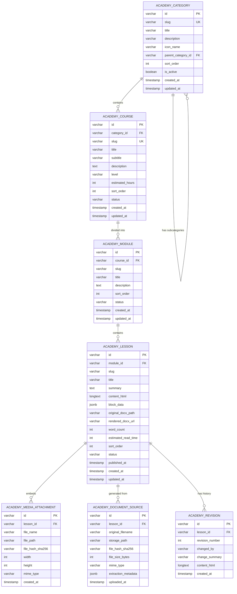

# IntelligentQA Academy — Database & Storage Design Specification

> **Document Version:** 1.0.0  
> **Author:** Senior Full Stack Architect & Technical Lead  
> **Status:** Proposal / Review  
> **Target Audience:** Database Engineers, Backend Developers, Technical Leadership  

---

## 1. Design Overview & Storage Strategy

The IntelligentQA platform currently supports a dual-persistence strategy:
1. **Lightweight JSON Store (`src/lib/curriculum-data-store.json`)**: An atomic, zero-configuration local persistence layer used for quick development, staging, or simple single-instance hosting.
2. **Relational Database (`scripts/schema.sql` -> PostgreSQL / SQLite)**: An enterprise-grade schema used for production workloads, strict referential integrity, complex queries, and ACID guarantees.

The Learning Academy database schema is designed to **seamlessly support both environments** without breaking existing tables or stored JSON structures.

---

## 2. Entity-Relationship Model (Relational)



---

## 3. Relational DDL (PostgreSQL & SQLite Compatible)

This DDL can be added directly to `scripts/schema.sql` or applied as a migration:

```sql
-- =============================================================================
-- INTELLIGENTQA ACADEMY SCHEMA EXTENSION
-- =============================================================================

-- 1. Academy Categories (Supports hierarchical trees like Git & CI/CD -> GitHub Actions)
CREATE TABLE IF NOT EXISTS academy_categories (
    id VARCHAR(64) PRIMARY KEY,
    slug VARCHAR(128) NOT NULL UNIQUE,
    title VARCHAR(255) NOT NULL,
    description TEXT,
    icon_name VARCHAR(64) DEFAULT 'FolderBook',
    parent_category_id VARCHAR(64) REFERENCES academy_categories(id) ON DELETE SET NULL,
    sort_order INT NOT NULL DEFAULT 0,
    is_active BOOLEAN NOT NULL DEFAULT TRUE,
    created_at TIMESTAMP WITH TIME ZONE DEFAULT CURRENT_TIMESTAMP,
    updated_at TIMESTAMP WITH TIME ZONE DEFAULT CURRENT_TIMESTAMP
);

CREATE INDEX IF NOT EXISTS idx_academy_categories_parent ON academy_categories(parent_category_id);
CREATE INDEX IF NOT EXISTS idx_academy_categories_sort ON academy_categories(sort_order);

-- 2. Academy Courses
CREATE TABLE IF NOT EXISTS academy_courses (
    id VARCHAR(64) PRIMARY KEY,
    category_id VARCHAR(64) NOT NULL REFERENCES academy_categories(id) ON DELETE CASCADE,
    slug VARCHAR(128) NOT NULL UNIQUE,
    title VARCHAR(255) NOT NULL,
    subtitle VARCHAR(255),
    description TEXT,
    level VARCHAR(32) DEFAULT 'All Levels', -- Beginner, Intermediate, Advanced
    estimated_hours INT DEFAULT 0,
    sort_order INT NOT NULL DEFAULT 0,
    status VARCHAR(32) NOT NULL DEFAULT 'published', -- draft, published, archived
    created_at TIMESTAMP WITH TIME ZONE DEFAULT CURRENT_TIMESTAMP,
    updated_at TIMESTAMP WITH TIME ZONE DEFAULT CURRENT_TIMESTAMP
);

CREATE INDEX IF NOT EXISTS idx_academy_courses_cat ON academy_courses(category_id);
CREATE INDEX IF NOT EXISTS idx_academy_courses_slug ON academy_courses(slug);
CREATE INDEX IF NOT EXISTS idx_academy_courses_sort ON academy_courses(sort_order);

-- 3. Academy Modules (Course Chapters/Sections)
CREATE TABLE IF NOT EXISTS academy_modules (
    id VARCHAR(64) PRIMARY KEY,
    course_id VARCHAR(64) NOT NULL REFERENCES academy_courses(id) ON DELETE CASCADE,
    slug VARCHAR(128) NOT NULL,
    title VARCHAR(255) NOT NULL,
    description TEXT,
    sort_order INT NOT NULL DEFAULT 0,
    status VARCHAR(32) NOT NULL DEFAULT 'published',
    created_at TIMESTAMP WITH TIME ZONE DEFAULT CURRENT_TIMESTAMP,
    updated_at TIMESTAMP WITH TIME ZONE DEFAULT CURRENT_TIMESTAMP,
    CONSTRAINT uq_module_course_slug UNIQUE (course_id, slug)
);

CREATE INDEX IF NOT EXISTS idx_academy_modules_course ON academy_modules(course_id);
CREATE INDEX IF NOT EXISTS idx_academy_modules_sort ON academy_modules(sort_order);

-- 4. Academy Lessons
CREATE TABLE IF NOT EXISTS academy_lessons (
    id VARCHAR(64) PRIMARY KEY,
    module_id VARCHAR(64) NOT NULL REFERENCES academy_modules(id) ON DELETE CASCADE,
    slug VARCHAR(128) NOT NULL,
    title VARCHAR(255) NOT NULL,
    summary TEXT,
    content_html TEXT NOT NULL,
    block_data JSONB, -- Optional Editor.js / Tiptap block AST
    original_docx_path VARCHAR(512),
    rendered_docx_url VARCHAR(512),
    word_count INT DEFAULT 0,
    estimated_read_time INT DEFAULT 1, -- in minutes
    sort_order INT NOT NULL DEFAULT 0,
    status VARCHAR(32) NOT NULL DEFAULT 'published',
    published_at TIMESTAMP WITH TIME ZONE,
    created_at TIMESTAMP WITH TIME ZONE DEFAULT CURRENT_TIMESTAMP,
    updated_at TIMESTAMP WITH TIME ZONE DEFAULT CURRENT_TIMESTAMP,
    CONSTRAINT uq_lesson_module_slug UNIQUE (module_id, slug)
);

CREATE INDEX IF NOT EXISTS idx_academy_lessons_module ON academy_lessons(module_id);
CREATE INDEX IF NOT EXISTS idx_academy_lessons_slug ON academy_lessons(slug);
CREATE INDEX IF NOT EXISTS idx_academy_lessons_sort ON academy_lessons(sort_order);

-- 5. Document Sources (Tracking uploaded .docx files and processing metadata)
CREATE TABLE IF NOT EXISTS academy_document_sources (
    id VARCHAR(64) PRIMARY KEY,
    lesson_id VARCHAR(64) NOT NULL REFERENCES academy_lessons(id) ON DELETE CASCADE,
    original_filename VARCHAR(255) NOT NULL,
    storage_path VARCHAR(512) NOT NULL,
    file_hash_sha256 VARCHAR(64) NOT NULL,
    file_size_bytes INT NOT NULL,
    mime_type VARCHAR(128) NOT NULL,
    extraction_metadata JSONB, -- stores table counts, image counts, warnings
    uploaded_at TIMESTAMP WITH TIME ZONE DEFAULT CURRENT_TIMESTAMP
);

CREATE INDEX IF NOT EXISTS idx_academy_docs_lesson ON academy_document_sources(lesson_id);
CREATE INDEX IF NOT EXISTS idx_academy_docs_hash ON academy_document_sources(file_hash_sha256);

-- 6. Media Attachments (Images, diagrams extracted from Word docs or uploaded directly)
CREATE TABLE IF NOT EXISTS academy_media_attachments (
    id VARCHAR(64) PRIMARY KEY,
    lesson_id VARCHAR(64) REFERENCES academy_lessons(id) ON DELETE SET NULL,
    file_name VARCHAR(255) NOT NULL,
    file_path VARCHAR(512) NOT NULL,
    file_hash_sha256 VARCHAR(64) NOT NULL,
    width INT,
    height INT,
    mime_type VARCHAR(64) NOT NULL,
    created_at TIMESTAMP WITH TIME ZONE DEFAULT CURRENT_TIMESTAMP
);

CREATE INDEX IF NOT EXISTS idx_academy_media_lesson ON academy_media_attachments(lesson_id);
CREATE INDEX IF NOT EXISTS idx_academy_media_hash ON academy_media_attachments(file_hash_sha256);

-- 7. Lesson Revisions (Audit trail & version history for CMS edits)
CREATE TABLE IF NOT EXISTS academy_revisions (
    id VARCHAR(64) PRIMARY KEY,
    lesson_id VARCHAR(64) NOT NULL REFERENCES academy_lessons(id) ON DELETE CASCADE,
    revision_number INT NOT NULL,
    changed_by VARCHAR(128) NOT NULL,
    change_summary VARCHAR(255),
    content_html TEXT NOT NULL,
    created_at TIMESTAMP WITH TIME ZONE DEFAULT CURRENT_TIMESTAMP
);

CREATE INDEX IF NOT EXISTS idx_academy_revisions_lesson ON academy_revisions(lesson_id);
```

---

## 4. Local JSON Store Schema (`curriculum-data-store.json`)

To preserve zero-setup portability, `src/lib/curriculum-data-store.json` is augmented with an `academy` namespace. This keeps the existing `courses` array completely intact while providing rich nested tree querying:

```json
{
  "version": "2.0.0",
  "lastUpdated": "2026-11-23T12:00:00.000Z",
  "categories": [
    {
      "id": "cat_ai_for_qa",
      "slug": "ai-for-qa",
      "title": "AI for QA",
      "description": "AI-driven testing, LLM evaluations, autonomous test generation, and intelligent quality engineering.",
      "icon": "Bot",
      "sortOrder": 1,
      "parentCategoryId": null,
      "isActive": true
    },
    {
      "id": "cat_selenium",
      "slug": "selenium",
      "title": "Selenium",
      "description": "Enterprise test automation with Selenium WebDriver 4, Grid, and framework architecture.",
      "icon": "Globe",
      "sortOrder": 2,
      "parentCategoryId": null,
      "isActive": true
    },
    {
      "id": "cat_playwright",
      "slug": "playwright",
      "title": "Playwright",
      "description": "Modern end-to-end testing with Microsoft Playwright, auto-wait, and trace recording.",
      "icon": "Code2",
      "sortOrder": 3,
      "parentCategoryId": null,
      "isActive": true
    },
    {
      "id": "cat_rest_assured",
      "slug": "rest-assured",
      "title": "Rest Assured",
      "description": "Backend microservices and RESTful API automation with Rest Assured in Java.",
      "icon": "Zap",
      "sortOrder": 4,
      "parentCategoryId": null,
      "isActive": true
    },
    {
      "id": "cat_api_testing",
      "slug": "api-testing",
      "title": "API Testing",
      "description": "Postman, contract testing with Pact, performance testing, and API security testing.",
      "icon": "Layers",
      "sortOrder": 5,
      "parentCategoryId": null,
      "isActive": true
    },
    {
      "id": "cat_appium",
      "slug": "appium",
      "title": "Appium",
      "description": "Cross-platform mobile automation for iOS and Android native, hybrid, and web apps.",
      "icon": "Smartphone",
      "sortOrder": 6,
      "parentCategoryId": null,
      "isActive": true
    },
    {
      "id": "cat_git_cicd",
      "slug": "git-cicd",
      "title": "Git & CI/CD",
      "description": "Version control, continuous integration, and automated deployment pipelines.",
      "icon": "GitBranch",
      "sortOrder": 7,
      "parentCategoryId": null,
      "isActive": true
    },
    {
      "id": "cat_github_actions",
      "slug": "github-actions",
      "title": "GitHub Actions",
      "description": "Automated workflow pipelines, custom composite actions, and test runners.",
      "icon": "GitMerge",
      "sortOrder": 1,
      "parentCategoryId": "cat_git_cicd",
      "isActive": true
    },
    {
      "id": "cat_azure_devops",
      "slug": "azure-devops",
      "title": "Azure DevOps",
      "description": "Azure Pipelines, test plan integration, and release orchestrations.",
      "icon": "Cloud",
      "sortOrder": 2,
      "parentCategoryId": "cat_git_cicd",
      "isActive": true
    },
    {
      "id": "cat_jenkins",
      "slug": "jenkins",
      "title": "Jenkins",
      "description": "Declarative Jenkinsfiles, distributed agent grids, and pipeline monitoring.",
      "icon": "Server",
      "sortOrder": 3,
      "parentCategoryId": "cat_git_cicd",
      "isActive": true
    }
  ],
  "academyCourses": [
    {
      "id": "course_playwright_mastery",
      "categoryId": "cat_playwright",
      "slug": "playwright-mastery",
      "title": "Playwright Automation Mastery",
      "subtitle": "From Zero to Production-Ready Automation Framework",
      "description": "Comprehensive guide to automating web apps using Playwright with TypeScript.",
      "level": "Intermediate",
      "sortOrder": 1,
      "status": "published",
      "modules": [
        {
          "id": "mod_pw_1",
          "slug": "getting-started",
          "title": "Module 1: Getting Started with Playwright",
          "description": "Installation, configuration, and first test execution.",
          "sortOrder": 1,
          "status": "published",
          "lessons": [
            {
              "id": "les_pw_1_1",
              "slug": "environment-setup",
              "title": "Lesson 1.1: Environment Setup & Architecture",
              "summary": "Setting up Node.js, Playwright Test runner, and project scaffolding.",
              "contentHtml": "<p>Content generated from Word Document...</p>",
              "originalDocx": "/uploads/learning/docx/pw_les_1_1.docx",
              "wordCount": 1420,
              "estimatedReadTime": 7,
              "sortOrder": 1,
              "status": "published",
              "updatedAt": "2026-11-23T12:00:00.000Z"
            }
          ]
        }
      ]
    }
  ]
}
```

---

## 5. Proposed REST API Endpoints Specification

All endpoints follow the project's standard response envelope:
```json
{
  "success": true,
  "data": { ... },
  "message": "Operation completed successfully"
}
```

### 5.1 Public Learner Endpoints

| Method | Endpoint | Description | Cache / Performance |
| :--- | :--- | :--- | :--- |
| `GET` | `/api/learning/tree` | Returns complete navigation tree (Categories -> Courses -> Modules -> Lessons) | Public cached (SWR / 60s ISR) |
| `GET` | `/api/learning/categories` | List all top-level learning categories | Public cached |
| `GET` | `/api/learning/categories/[slug]` | Get category detail and its child courses | Public cached |
| `GET` | `/api/learning/courses/[slug]` | Get course overview, syllabus, and module list | Public cached |
| `GET` | `/api/learning/lessons/[id]` | Fetch single lesson content, breadcrumbs, previous & next pointers | Public cached / On-Demand Revalidate |
| `GET` | `/api/learning/search?q={query}` | Full-text fuzzy search across all published lessons | In-memory index / < 20ms |

### 5.2 Admin Endpoints (Guarded by Passcode & Admin RBAC)

| Method | Endpoint | Description | Payload / Action |
| :--- | :--- | :--- | :--- |
| `POST` | `/api/learning/categories` | Create new category | `{ title, slug, description, parentId, icon }` |
| `PUT` | `/api/learning/categories/[id]` | Update category details | Partial `{ title, description, ... }` |
| `DELETE`| `/api/learning/categories/[id]` | Delete category (cascades or prevents if non-empty) | `{ force: boolean }` |
| `POST` | `/api/learning/courses` | Create new course in category | `{ categoryId, title, slug, level, ... }` |
| `PUT` | `/api/learning/courses/[id]` | Update course metadata | Partial `{ title, status, ... }` |
| `POST` | `/api/learning/modules` | Create module in course | `{ courseId, title, slug, ... }` |
| `PUT` | `/api/learning/modules/[id]` | Update module details | Partial `{ title, ... }` |
| `POST` | `/api/learning/lessons` | Create manual lesson | `{ moduleId, title, contentHtml, ... }` |
| `PUT` | `/api/learning/lessons/[id]` | Update lesson content / status | `{ contentHtml, status, title }` |
| `POST` | `/api/learning/docx/import` | Upload & convert `.docx` document | `multipart/form-data` (file, moduleId, courseId) |
| `POST` | `/api/learning/curriculum/reorder`| Bulk reorder tree items | `{ type: 'course'\|'module'\|'lesson', orderedIds: [] }` |
| `POST` | `/api/learning/media/upload` | Direct media upload for lessons | `multipart/form-data` (image/diagram) |

---

## 6. Data Integrity & Migration Strategy

### 6.1 Foreign Key Cascade Rules
- **Deleting a Category**: Restricted if child courses exist, unless `cascade=true` is explicitly requested by super admin.
- **Deleting a Course**: Cascades to modules and lessons, moving associated uploaded `.docx` files to a `.trash` archive folder for 30 days before hard deletion.
- **Deleting a Lesson**: Deletes revision history and detaches media references.

### 6.2 Atomic Write Locking for JSON Store
When operating in local JSON mode (`curriculum-data-store.json`), simultaneous admin operations are serialized using the existing atomic temporary write technique:
1. Read current state.
2. Apply mutation in memory.
3. Write to temporary file (`curriculum-data-store.json.tmp`).
4. Atomically rename temporary file to destination (`fs.promises.rename`).
5. Emit `intelligentqa_curriculum_updated` system event to trigger client revalidation.

---

*End of Database Design Document. Approved for Phase 0 review.*
