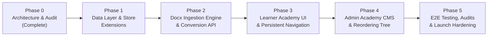

# IntelligentQA Academy — Phase-Wise Implementation Roadmap

> **Document Version:** 1.0.0  
> **Author:** Senior Full Stack Architect & Technical Lead  
> **Status:** Proposal / Review  
> **Target Audience:** Engineering Team, QA Engineers, DevOps, Leadership

---

## 1. Roadmap Overview & Phased Milestones

To guarantee zero regression of existing functionality and ensure continuous delivery of value, the Learning Academy implementation is partitioned into **5 sequential phases**.

---

## 2. Detailed Phase Breakdown

### Phase 1: Core Data Models & Store Extensions

**Objective:** Establish the persistent data layer, models, and CRUD services for the 4-tier hierarchy without touching frontend UI.

- **Key Deliverables:**
  1. Define TypeScript types and interfaces (`src/types/learning-platform.ts`).
  2. Implement data access layer supporting both `curriculum-data-store.json` and PostgreSQL DDL (`src/lib/academy-store.ts`).
  3. Pre-seed the required learning categories:
     - `AI for QA`
     - `Selenium`
     - `Playwright`
     - `Rest Assured`
     - `API Testing`
     - `Appium`
     - `Git & CI/CD` (with subcategories: `GitHub Actions`, `Azure DevOps`, `Jenkins`).
  4. Implement public read Route Handlers:
     - `/api/learning/tree`
     - `/api/learning/categories`
     - `/api/learning/courses/[slug]`
     - `/api/learning/lessons/[id]`
  5. Add automated unit tests for data integrity and atomic file writing.

- **Verification Gate:**
  - Automated tests pass with 100% test coverage for category hierarchy and tree generation.
  - Zero disruption to existing `src/lib/curriculum-data-store.json` course items.

---

### Phase 2: Word Document (.docx) Ingestion & Conversion Engine

**Objective:** Implement server-side document parsing, asset extraction, HTML cleanup, and storage pipelines using free open-source tooling.

- **Key Deliverables:**
  1. Integrate `mammoth.js` for Node.js server-side conversion with custom style mapping:
     - Headings (`Heading 1`, `Heading 2`, `Heading 3`) mapped to `<h2>`, `<h3>`, `<h4>`.
     - Code blocks and monospace font preservation.
     - Table styling and callout box recognition.
  2. Implement image extraction pipeline:
     - Inline images extracted, hashed (SHA-256), deduplicated, and stored in `public/uploads/learning/media/`.
  3. Implement HTML post-processing and sanitization via `cheerio` / `DOMPurify`.
  4. Implement Admin Upload API:
     - `POST /api/learning/docx/import` accepting multipart `.docx` uploads.
     - Returns converted HTML, extracted image references, word count, and preview payload.
  5. Save original `.docx` binary in `public/uploads/learning/docx/` for reference and download.

- **Verification Gate:**
  - Test suite with sample `.docx` files containing complex tables, code blocks, images, and nested bullet points.
  - Verification that XSS payloads embedded inside Word documents are completely sanitized.

---

### Phase 3: Learner Experience & Responsive Navigation

**Objective:** Build the public-facing Learning Academy reader with persistent left navigation, breadcrumbs, smooth lesson switching, and mobile drawer.

- **Key Deliverables:**
  1. Create Academy routing layout:
     - `src/app/learning/layout.tsx` (Persistent shell).
     - `src/app/learning/page.tsx` (Academy home & category matrix).
     - `src/app/learning/[categorySlug]/[courseSlug]/[lessonSlug]/page.tsx` (Lesson reader).
  2. Implement `LearningSidebar`:
     - Persistent 4-tier tree: Category -> Course -> Module -> Lesson.
     - Smooth accordion expansions with state retention.
     - Search and filter input.
  3. Implement `LessonContentPanel`:
     - Instant client-side lesson switching without full page reload.
     - Dual-mode toggle: Web View (default) vs. High-Fidelity Document View (powered by `docx-preview`).
     - Previous / Next navigation controls with keyboard navigation.
     - Interactive breadcrumb trail.
     - Table of Contents (TOC) auto-generated from `<h2>`/`<h3>` headings.
  4. Fully responsive styling matching dark theme tokens (`#111111`, `#161616`, `#81FF89`).

- **Verification Gate:**
  - Zero full-page reload on lesson navigation.
  - Responsive behavior validated on desktop, iPad/tablet, and mobile screen sizes.

---

### Phase 4: Admin Academy Console & Management UI

**Objective:** Provide an intuitive admin dashboard to manage courses, upload documents, reorder items, and publish content without code deployments.

- **Key Deliverables:**
  1. Add Academy Admin view under `src/app/admin/academy/page.tsx`.
  2. Visual Tree Manager:
     - Drag-and-drop or button-based reordering of categories, courses, modules, and lessons.
     - Direct creation and editing modals for categories and modules.
  3. Document Ingestion Modal:
     - Drag-and-drop zone for `.docx` files.
     - Live side-by-side preview before publishing.
     - Auto-split options based on Heading 1 markers.
  4. Publish / Unpublish toggles and status badges (`draft`, `published`, `archived`).
  5. Handoff to existing `RichBlockEditor` for manual text and code fine-tuning.

- **Verification Gate:**
  - Non-technical administrator can upload a `.docx` file and have it live on the site in under 30 seconds.
  - Role-based permissions and passcode verification prevent unauthorized access.

---

### Phase 5: Testing, Hardening, Performance & Launch

**Objective:** Comprehensive end-to-end testing, accessibility audit, performance optimization, and production deployment preparation.

- **Key Deliverables:**
  1. Automated E2E test suite covering:
     - Category and lesson navigation flows.
     - Document upload and conversion round-trip.
     - Admin authentication and reordering.
  2. Performance audits:
     - Core Web Vitals (LCP < 1.2s, CLS 0, INP < 100ms).
     - On-demand ISR revalidation on publish.
  3. Accessibility review (WCAG 2.1 AA compliance, keyboard navigation, ARIA attributes).
  4. Documentation updates and administrator onboarding guide.

---

## 3. Concrete Files Impact Analysis

### 3.1 Files to CREATE

| File Path                                                            | Purpose                                                                                       |
| :------------------------------------------------------------------- | :-------------------------------------------------------------------------------------------- |
| `src/types/learning-platform.ts`                                     | Complete TypeScript type definitions for categories, courses, modules, lessons, and documents |
| `src/lib/academy-store.ts`                                           | Data access layer for reading/writing academy entities to JSON and PostgreSQL                 |
| `src/lib/docx-converter.ts`                                          | Server-side conversion engine wrapping `mammoth.js` and asset extractors                      |
| `src/app/api/learning/tree/route.ts`                                 | Public API endpoint returning the full navigation tree                                        |
| `src/app/api/learning/categories/route.ts`                           | Category CRUD Route Handler                                                                   |
| `src/app/api/learning/courses/route.ts`                              | Course CRUD Route Handler                                                                     |
| `src/app/api/learning/modules/route.ts`                              | Module CRUD Route Handler                                                                     |
| `src/app/api/learning/lessons/route.ts`                              | Lesson CRUD Route Handler                                                                     |
| `src/app/api/learning/docx/import/route.ts`                          | Document upload and conversion Route Handler                                                  |
| `src/app/api/learning/curriculum/reorder/route.ts`                   | Hierarchy reordering Route Handler                                                            |
| `src/app/learning/layout.tsx`                                        | Academy persistent layout shell with sidebar context                                          |
| `src/app/learning/page.tsx`                                          | Academy dashboard and category catalog                                                        |
| `src/app/learning/[categorySlug]/[courseSlug]/[lessonSlug]/page.tsx` | Dynamic lesson reader                                                                         |
| `src/components/learning/learning-sidebar.tsx`                       | Persistent left navigation sidebar                                                            |
| `src/components/learning/lesson-content-panel.tsx`                   | Right-side dynamic lesson content reader                                                      |
| `src/components/learning/lesson-breadcrumb.tsx`                      | Hierarchical breadcrumbs                                                                      |
| `src/components/learning/lesson-navigation-footer.tsx`               | Previous/Next navigation footer                                                               |
| `src/components/learning/docx-fidelity-viewer.tsx`                   | Client-side `docx-preview` high-fidelity renderer                                             |
| `src/app/admin/academy/page.tsx`                                     | Admin Academy management console                                                              |
| `src/components/admin/docx-upload-modal.tsx`                         | Admin Word document uploader with live preview                                                |
| `src/components/admin/tree-reorder-manager.tsx`                      | Visual drag-and-drop hierarchy reorderer                                                      |
| `tests/academy-store.test.js`                                        | Unit test suite for academy data store                                                        |
| `tests/docx-converter.test.js`                                       | Ingestion engine test suite with fixture Word documents                                       |

### 3.2 Files to MODIFY (Minimal & Non-Breaking)

| File Path                                   | Changes Required                                                                         | Risk Level |
| :------------------------------------------ | :--------------------------------------------------------------------------------------- | :--------- |
| `src/lib/curriculum-data-store.json`        | Add `categories` array and initial academy categories (zero changes to existing courses) | Low        |
| `scripts/schema.sql`                        | Append `academy_*` tables to existing SQL schema                                         | Low        |
| `src/components/navigation/site-header.tsx` | Add "Academy" navigation link to top header                                              | Low        |
| `src/app/admin/page.tsx`                    | Add "Academy Manager" quick-access card to the admin dashboard                           | Low        |
| `package.json`                              | Add `mammoth` (server-side) and `docx-preview` (client-side) open-source libraries       | Low        |

---

## 4. Risk Assessment & Mitigation Matrix

| Risk ID  | Identified Risk                                                     | Severity | Probability | Mitigation Strategy                                                                                                                                         |
| :------- | :------------------------------------------------------------------ | :------- | :---------- | :---------------------------------------------------------------------------------------------------------------------------------------------------------- |
| **R-01** | Complex Word document tables or shapes lose styling in web HTML     | Medium   | High        | **Hybrid Viewer:** Default to semantic HTML for responsive reading, but provide a 1-click "Original Layout" view using `docx-preview` for exact pagination. |
| **R-02** | Large Word files with many uncompressed images cause upload latency | Medium   | Medium      | Client-side file size warnings (>50MB), server-side async stream processing, and image deduplication.                                                       |
| **R-03** | Concurrent admin edits causing JSON store write conflicts           | Low      | Low         | Implement atomic temporary write + file rename (`fs.promises.rename`) pattern with file locking.                                                            |
| **R-04** | Breaking existing `/courses` or `/admin/cms` workflows              | High     | Low         | Complete isolation: Academy operates on dedicated `/app/learning/` routes and distinct store keys without altering existing routes.                         |
| **R-05** | Malicious file upload or XSS payload hidden inside `.docx`          | High     | Low         | Validate file magic numbers (ZIP signature), sanitize extracted HTML with DOMPurify, and disallow executable extensions.                                    |

---

## 5. Testing & Verification Strategy

1. **Unit Testing (Node.js Test Runner):**
   - Store operations: category creation, module nesting, cascading deletes.
   - DOCX parsing: verifying that headings, bullet points, tables, and images are correctly extracted from sample files.
2. **Regression Testing:**
   - Run the existing test suite (`npm test`) before and after every phase to guarantee all existing 296 tests pass without regression.
3. **Cross-Browser & Device Testing:**
   - Chrome, Firefox, Safari, Edge.
   - iOS Safari and Android Chrome responsive navigation checks.
4. **Performance Verification:**
   - Ensure dynamic lesson navigation loads under 150ms with zero layout shifts (CLS = 0).

---

_End of Implementation Roadmap. Approved for Phase 0 review._
