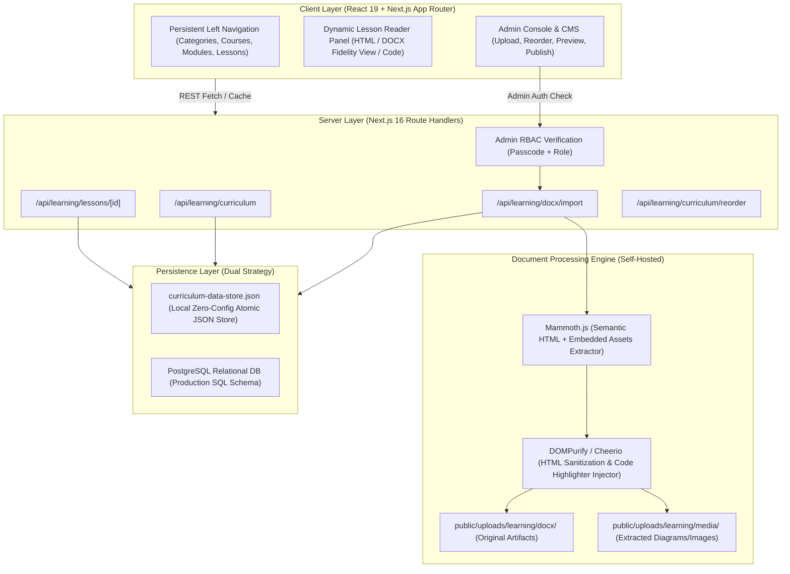

# IntelligentQA Academy — Proposed System Architecture

> **Document Version:** 1.0.0  
> **Author:** Senior Full Stack Architect & Technical Lead  
> **Status:** Proposal / Review  
> **Target Audience:** Engineering Team, Product Owner, Technical Leadership

---

## 1. Executive Summary & Architecture Philosophy

The **IntelligentQA Learning Academy & Technical Documentation Platform** extends the existing IntelligentQA Community platform into a comprehensive, enterprise-ready technical learning and documentation hub.

### Core Architecture Tenets

1. **Zero Greenfield Disruption:** The architecture builds directly on top of the existing Next.js 16 App Router, React 19, Tailwind CSS v4, and existing persistence layer (`curriculum-data-store.json` + PostgreSQL relational migration path).
2. **Strictly Free & Open-Source:** Zero proprietary cloud APIs, paid SaaS services, or recurring third-party subscriptions. Every conversion, indexing, rendering, and storage component runs self-hosted.
3. **No Code Deployments for Content:** Course administrators can create categories, courses, modules, and lessons dynamically from the Admin Console, upload `.docx` technical guides, reorder curriculum items via drag-and-drop, and publish instantly without committing code or rebuilding the application.
4. **Hybrid Document Ingestion & High-Fidelity Rendering:** Balancing the responsiveness and accessibility of responsive web HTML with the strict formatting fidelity of complex enterprise Microsoft Word documents (tables, diagrams, code blocks, callouts, and page layouts).
5. **Instantaneous Client Navigation:** Zero full-page reloads when navigating between modules and lessons, preserving scroll states and user focus through React 19 transitions and optimistic caching.

---

## 2. High-Level System Architecture Diagram



---

## 3. Learning Navigation & Information Architecture

### 3.1 Required Navigation Hierarchy

The platform organizes learning materials into a strict 4-level hierarchy:

```text
Level 1: Category (e.g., "AI for QA", "Selenium", "Git & CI/CD")
  └── Level 2: Course (e.g., "GitHub Actions Masterclass")
        └── Level 3: Module (e.g., "Module 1: Workflow Triggers & Contexts")
              └── Level 4: Lesson (e.g., "Lesson 1.2: Repository Dispatch & Webhooks")
```

#### Category Taxonomy (Pre-seeded & Dynamic)

1. **AI for QA** (Generative AI testing, LLM evals, prompt regression, synthetic test generation)
2. **Selenium** (Selenium WebDriver 4, Grid, architecture, locators, cross-browser automation)
3. **Playwright** (Modern E2E automation, trace viewer, network mocking, component testing)
4. **Rest Assured** (API testing, schema validation, payload serialization, OAuth2 auth)
5. **API Testing** (Postman, Newman, contract testing with Pact, GraphQL testing)
6. **Appium** (Mobile automation for Android/iOS, device clouds, gesture automation)
7. **Git & CI/CD**
   - **GitHub Actions**
   - **Azure DevOps**
   - **Jenkins**

### 3.2 Dynamic Hierarchy Model

To allow unlimited nested groupings without schema redesign, categories support optional parent-child relationships (e.g., Category: "Git & CI/CD" -> Subcategories: "GitHub Actions", "Azure DevOps", "Jenkins").

---

## 4. Frontend Component Architecture

### 4.1 Component Tree & Responsibilities

```text
src/app/learning/
├── layout.tsx                     # Academy Shell (Sidebar context, persistent layout)
├── page.tsx                       # Academy Overview & Category Dashboard
├── [categorySlug]/
│   ├── page.tsx                   # Category Landing Page
│   └── [courseSlug]/
│       ├── page.tsx               # Course Syllabus & Intro
│       └── [lessonSlug]/
│           └── page.tsx           # Lesson Reader (Dynamic SSR + Client Content Panel)
```

#### Key Component Breakdown:

1. **`LearningSidebar` (`src/components/learning/learning-sidebar.tsx`)**
   - **Persistent layout**: Rendered once inside `layout.tsx`; never unmounts during lesson transitions.
   - **Accordion state**: Remembers expanded categories and modules across navigation (persisted in `localStorage` or URL query state).
   - **Active lesson highlight**: Visual accent `#81FF89` with subtle glowing borders conforming to the dark aesthetic (`#111111`, `#161616`, `#262626`).
   - **Search / Filter bar**: Quick client-side fuzzy filter across all published lessons and modules.
   - **Mobile Drawer**: Responsive slide-over drawer triggered by header hamburger menu on `< md` screens.

2. **`LessonContentPanel` (`src/components/learning/lesson-content-panel.tsx`)**
   - **Zero full-page reload**: Uses Next.js soft navigation and React transitions (`useTransition`) to fetch next lesson data or switch active view client-side.
   - **Dual-View Rendering Engine**:
     - **Web Reading Mode (Default)**: Sanitized semantic HTML rendered via Tailwind Typography (`prose prose-invert`), custom table styling, syntax-highlighted code blocks, copy-to-clipboard buttons, and responsive image lightboxes.
     - **High-Fidelity Document Mode (Toggle)**: In-browser canvas/SVG rendering powered by `docx-preview` for technical users requiring exact Word layout (paginated headers, footers, complex multi-column matrices).
   - **Reading Progress & Completion**: Checkbox / progress tracker synced to user profile (`QADatabase`).

3. **`LessonBreadcrumb` (`src/components/learning/lesson-breadcrumb.tsx`)**
   - Interactive hierarchical trail: `Home > Learning Academy > Git & CI/CD > GitHub Actions > Module 2 > Lesson 2.3`.

4. **`LessonNavigationFooter` (`src/components/learning/lesson-navigation-footer.tsx`)**
   - "Previous Lesson" and "Next Lesson" navigation cards with titles, module names, and keyboard shortcuts (`Cmd/Ctrl + ArrowRight`, `Cmd/Ctrl + ArrowLeft`).

---

## 5. Document Import & Conversion Architecture (DOCX)

Preserving Microsoft Word `.docx` formatting without proprietary cloud services (like Microsoft 365 Graph or AWS Textract) requires an intelligent, multi-stage hybrid pipeline.

### 5.1 Library Evaluation Matrix

| Library                    | Strengths                                                                                                                                                                              | Limitations                                                                                                                                           | Recommendation                                                       |
| :------------------------- | :------------------------------------------------------------------------------------------------------------------------------------------------------------------------------------- | :---------------------------------------------------------------------------------------------------------------------------------------------------- | :------------------------------------------------------------------- |
| **`mammoth.js`**           | • 100% JavaScript (zero native dependencies)<br>• Converts `.docx` to semantic HTML<br>• Extracts inline images cleanly<br>• Fast and secure execution in Node.js serverless functions | • Ignores page breaks and exact margins<br>• Simplified table layouts<br>• Does not preserve complex shapes/SmartArt                                  | **Primary Ingestion Engine** (Generates responsive web content)      |
| **`docx-preview`**         | • Pure client-side browser rendering<br>• Near pixel-perfect Word canvas/DOM rendering<br>• Preserves pagination, page breaks, headers/footers                                         | • Client-only (heavy for mobile web)<br>• HTML is difficult to edit or index for full-text search                                                     | **High-Fidelity Reader Option** (Rendered client-side on demand)     |
| **`LibreOffice Headless`** | • Industry-standard fidelity<br>• Direct `.docx` to PDF / HTML conversion                                                                                                              | • Requires heavy OS package (`apt install libreoffice`)<br>• High CPU/memory overhead<br>• Incompatible with standard serverless/Vercel edge runtimes | **Optional Self-Hosted Worker** (For on-prem Docker/VPS setups only) |
| **`Tiptap / Editor.js`**   | • Structured block-based editor<br>• Perfect for fine-tuning converted lessons<br>• Already compatible with existing `rich-block-editor.tsx`                                           | • Cannot directly parse raw `.docx` binaries without an intermediate parser                                                                           | **Post-Import Content Refinement** (Admin editing interface)         |

### 5.2 Recommended Hybrid Ingestion Architecture

```mermaid
sequenceDiagram
    autonumber
    actor Admin as Course Administrator
    participant UI as Admin CMS UI
    participant API as /api/learning/docx/import
    participant Storage as File Storage (public/uploads/)
    participant Mammoth as Mammoth.js Engine
    participant Sanitizer as Cheerio / DOMPurify
    participant DB as Curriculum Database

    Admin->>UI: Uploads "Selenium_Grid_Mastery.docx"
    UI->>API: POST multipart/form-data (file, courseId, moduleId)
    API->>Storage: Save raw .docx binary (for audit, high-fidelity view & download)
    API->>Mammoth: mammoth.convertToHtml(buffer, options)
    Note over Mammoth: Extracts images to disk;<br/>Converts headings, tables, lists, text formatting
    Mammoth-->>API: Raw HTML + Extracted Image References
    API->>Sanitizer: Sanitize HTML, tag code blocks, transform image URLs
    Sanitizer-->>API: Clean, Responsive Web HTML
    API->>DB: Create Lesson Record (htmlContent, docxUrl, title, slug)
    DB-->>API: Lesson Created (ID, Slug)
    API-->>UI: 201 Created + Preview Payload
    UI->>Admin: Displays Live Preview (Responsive Web View + Raw Docx Toggle)
```

### 5.3 Technical Preservation Details

1. **Tables:**
   - Word tables are transformed into standard `<table>` elements wrapped in a responsive `<div class="overflow-x-auto">` container with dark-themed borders (`border-neutral-800`), zebra striping, and sticky header rows.
2. **Images & Diagrams:**
   - Inlined binary images inside `.docx` (PNG, JPEG, EMF, SVG) are automatically extracted during the Mammoth pipeline, hashed for deduplication, saved to `public/uploads/learning/media/[hash].[ext]`, and replaced in the HTML with responsive `` tags.
3. **Code Snippets:**
   - Word styles designated as "Code", "Source Code", or monospace font blocks (Consolas, Courier New, Menlo) are converted into semantic `<pre><code>...</code></pre>` blocks with syntax highlighting classes (compatible with Prism.js / Highlight.js).
4. **Headings & Outline:**
   - Word Heading 1, 2, 3 styles are mapped directly to `<h2>`, `<h3>`, `<h4>` tags, automatically generating a lesson Table of Contents (TOC) displayed on the right sidebar.
5. **Page Breaks:**
   - Page break markers (`<w:br w:type="page"/>`) are converted to `<hr class="lesson-page-break" data-page-break="true" />` dividers, allowing users to navigate paginated documents or read continuously.

---

## 6. Admin Experience & Content Management

### 6.1 Admin Console Capabilities

Located under `/admin/academy` (integrated seamlessly with the existing `/admin` and `/admin/cms` workflows):

1. **Course & Module Tree Manager:**
   - Visual drag-and-drop hierarchy tree to reorder categories, courses, modules, and lessons.
   - Batch publish/unpublish toggle.
2. **One-Click Word Document Importer:**
   - Drop zone for single or multi-chapter `.docx` files.
   - Auto-detection of chapter titles based on Heading 1 to auto-split large documents into multiple lessons.
3. **Integrated Content Previewer:**
   - Split-screen comparison: Left side displays the raw Word document structure, right side displays the real-time responsive web layout.
4. **Direct Rich-Text Tweaker:**
   - Seamless handoff to the existing `RichBlockEditor` to fix typos, add video embeds (YouTube / Vimeo / MP4), or add interactive quiz questions.

---

## 7. Security, Authorization & Integrity

### 7.1 Access Control (RBAC)

- **Public / Community Members:** Read-only access to published courses, modules, and lessons.
- **Instructors / Authors:** Create and edit drafted content within assigned categories.
- **Super Administrators:** Full write/publish/delete/reorder permissions, access to system audit logs, file uploads, and raw database exports.
- **Enforcement:** All mutations guarded by `verifyAdminPasscode` and `QADatabase.isAdmin(user)` server-side checks.

### 7.2 Content Sanitization & XSS Prevention

- All imported Word document HTML must pass through server-side sanitization (`DOMPurify` / `isomorphic-dompurify` or `sanitize-html`) before persistence.
- Forbidden tags: `<script>`, `<iframe src="javascript:...">`, `<object>`, `<embed>`, raw inline `onclick` or event handler attributes.
- Permitted embedded media: Whitelisted iframe sources (`youtube.com`, `player.vimeo.com`, `loom.com`).

### 7.3 File Upload Security

- Strict MIME-type checking (`application/vnd.openxmlformats-officedocument.wordprocessingml.document`).
- File magic number validation (checking the ZIP header `PK\x03\x04` of `.docx` files).
- File size limit: 50MB per document (customizable in admin settings).
- Sanitized file naming: UUID or SHA-256 slugification to prevent path traversal (`../../`).

---

## 8. Performance & Scalability Strategy

1. **Static Pre-rendering & On-Demand Revalidation (ISR):**
   - Public lesson pages utilize Next.js `revalidatePath('/learning/[category]/[course]/[lesson]')` upon admin publication.
   - Instant TTFB (< 50ms) for community learners.
2. **Optimistic UI Updates:**
   - Drag-and-drop reordering updates the UI instantly, executing background API sync with rollback on network failure.
3. **Asset Deduplication:**
   - Images extracted from `.docx` files are content-hashed (SHA-256). Identical diagrams shared across multiple Word documents are stored only once.

---

## 9. Compatibility Assessment

| System Dimension     | Current Implementation                      | Proposed Learning Academy                                               | Verdict             |
| :------------------- | :------------------------------------------ | :---------------------------------------------------------------------- | :------------------ |
| **Framework**        | Next.js 16.4.6 App Router                   | Uses App Router subtrees (`/app/learning/`, `/app/admin/academy/`)      | **100% Compatible** |
| **Language**         | TypeScript 7.0.2 / React 19.3.1             | Standard React 19 Server/Client Components                              | **100% Compatible** |
| **Styling**          | Tailwind CSS v4 custom theme                | Uses existing `#111111`, `#161616`, `#81FF89` color tokens & typography | **100% Compatible** |
| **Data Store**       | `curriculum-data-store.json` + Postgres DDL | Extends JSON store and Postgres DDL without breaking existing fields    | **100% Compatible** |
| **Existing Courses** | Existing courses under `/courses`           | Untouched. Can be migrated or cross-linked into Academy categories      | **100% Compatible** |
| **Admin System**     | Existing `/admin` & `/admin/cms`            | Academy Admin embeds directly into existing Admin dashboard             | **100% Compatible** |

---

_End of Architecture Document. Approved for Phase 0 review._
